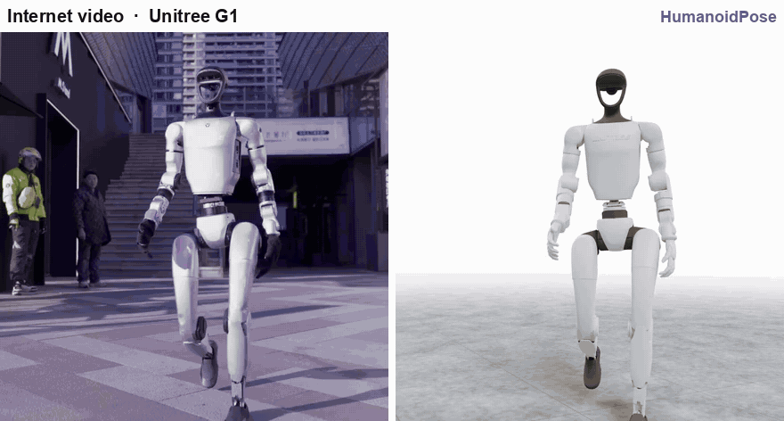
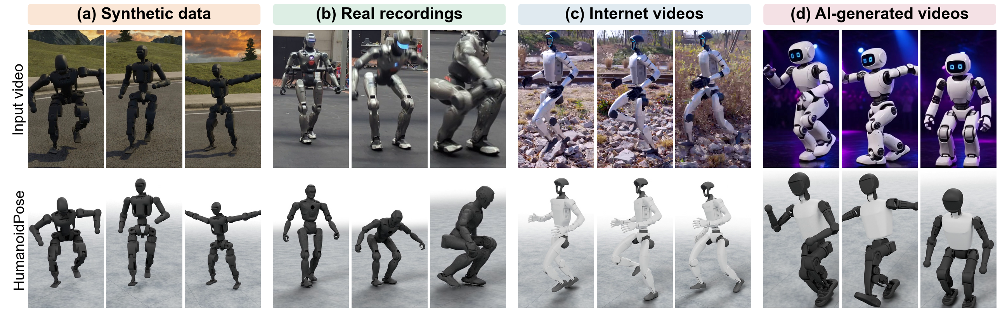
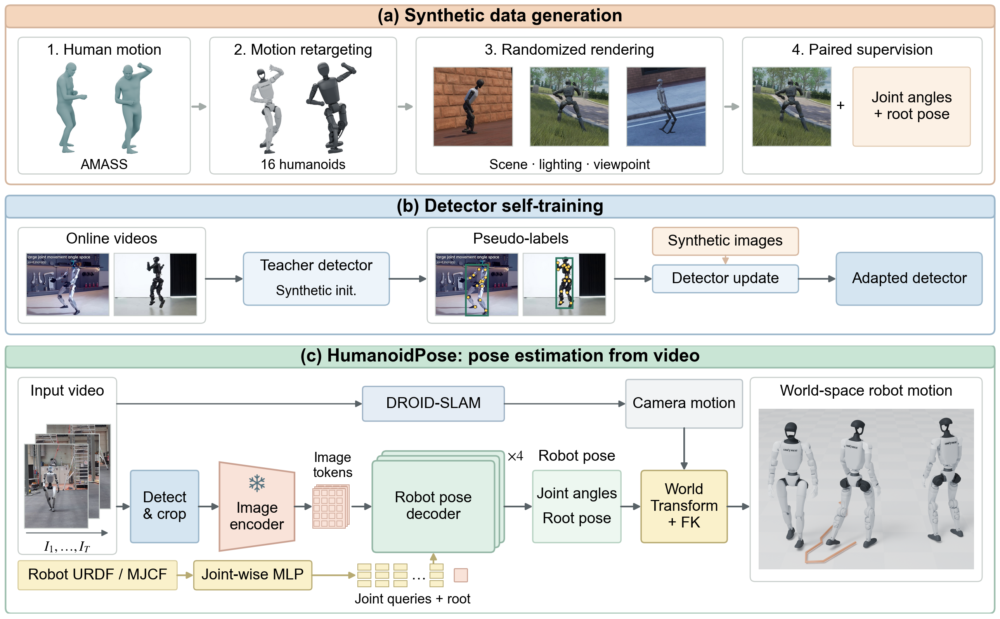

# Vision as Proprioception: Estimating Humanoid Robot Pose from Video

[Jiaxi Jiang](https://www.jiaxi-jiang.com/), [Matthias Heyrman](https://mheyrman.github.io/), [René Zurbrügg](https://renezurbruegg.github.io/), [Marco Hutter](https://rsl.ethz.ch/the-lab/people/person-detail.hutter.html), [Christian Holz](https://www.christianholz.net)

ETH Zürich

HumanoidPose reads a humanoid robot's full-body joint configuration and the pose of its root out
of ordinary video — no onboard state, no markers, no per-robot model. One unified model covers
sixteen humanoid embodiments: the robot's own kinematic description (an MJCF) tells the decoder
which joints to predict, so a robot it has never seen is added by pointing at its description.

Above: videos the model was never trained on, read one frame at a time — a manufacturer's
promotional clips of a Unitree G1, and generated videos in which no physical robot exists and no
encoder reading could exist. Left is the video, right is the configuration HumanoidPose recovers,
rendered from the robot's own kinematics.

## Any video becomes motion data

Joint configurations are what robot learning consumes, and they are exactly what video does not
carry. Synthetic renders come with them by construction and real recordings can be paired with
encoder logs, but internet and generated footage carries none — which is why reading the pose out
of the pixels turns all of that video into motion data. Each column shows three instants of one
clip, the input frames above and the recovered configurations below, for synthetic data,
real-robot recordings, internet videos and AI-generated videos.

## Method

A detector finds the robot and a square crop puts it at 55 % of the crop's height. The crop goes
through an image and camera encoder pretrained on humans, which stays frozen: the premise is that
a human visual prior transfers to humanoids. A kinematics-conditioned decoder then reads that
representation together with joint descriptors taken from the robot's MJCF — axis, place in the
chain, limits, side — and outputs that robot's joint coordinates and the pose of its root in the
camera frame. Because the robot description is an input rather than something baked into the
weights, one unified model serves every embodiment, and an unseen robot only needs its MJCF.

## Code and models

Coming soon — ⭐ star the repository to follow along.

## License and Acknowledgement

This repository is released under the MIT license. This work builds on
[PromptHMR](https://github.com/yufu-wang/PromptHMR) for the pretrained visual features,
[GMR](https://github.com/YanjieZe/GMR) and
[mujoco_menagerie](https://github.com/google-deepmind/mujoco_menagerie) for retargeting and the
robot descriptions, and [Ultralytics](https://github.com/ultralytics/ultralytics) YOLO11-pose for
detection. We thank their authors for releasing their work.
